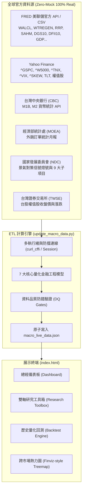

# MacroPulse 宏觀脈動 ── 內部核心量化架構與工程技術手冊（機密 / 對內專用）

> **【內部機密文件 · 僅供系統架構與演算法開發維護使用】**  
> 本文件詳盡記錄 MacroPulse 核心數據管線、各項金融工程計量模型、數據源 API 端點、子因子權重與資料品質防錯閘門（Data Quality Gates）。請勿將本手冊之實作細節外流或公開。

---

## 🏗️ 系統總體架構與工作流 (System Architecture)

---

## 🧠 七大核心量化模型計量邏輯與底層端點 (Core Quantitative Engines)

### 1. 美國 Fed 淨流動性指數（Fed Net Liquidity Tracker）
* **計量公式**：
  $$\text{Fed Net Liquidity} = \text{Fed 總資產 (WALCL)} - \text{財政部 TGA 帳戶 (WTREGEN)} - \text{隔夜逆回購 ON RRP (RRPONTSYD)}$$
* **FRED 官方序列編號**：
  - `WALCL`：Assets: Total Assets: Total Assets (Less Eliminations from Consolidation)（週頻，十億美元）
  - `WTREGEN`：Treasury General Account (TGA)（週頻，十億美元）
  - `RRPONTSYD`：Overnight Reverse Repurchase Agreements（日頻，十億美元）
* **演算法實作**：
  - 前向填補（`ffill`）對齊為相同日期序列。
  - 計算單月變動率（MoM %），判定資金水龍頭方向（擴張 / 收縮）。
  - 當流動性單月擴張 > 1.0% 為實質放水（Risk-On），單月收縮 > -1.0% 為資金抽水（Risk-Off）。

---

### 2. 薩姆規則衰退預警 ＆ 殖利率倒掛修復計（Sahm Rule & Yield Curve Meter）
* **薩姆規則 (Sahm Rule Recession Indicator)**：
  - FRED 序列：`SAHMREALTIME`（即時薩姆規則衰退指標）。
  - 公式：$\text{3 個月移動平均失業率} - \text{過去 12 個月失業率最低點}$。
  - 臨界門檻：
    - $\ge 0.50\%$：觸發歷史衰退警戒（自 1970 年代以來 100% 衰退命中率）。
    - $0.30\% \sim 0.50\%$：勞動市場放緩預警。
    - $< 0.30\%$：勞動市場安全擴張期。
* **殖利率倒掛修復計 (Yield Curve Un-inversion)**：
  - FRED 序列：`T10Y2Y`（10年期減2年期利差）、`T10Y3M`（10年期減3個月期利差）。
  - 量化邏輯：
    - 倒掛深淵（利差 $< 0\%$）：長線衰退警訊。
    - 陡峭化修復（利差自負值陡峭回升至 $> 0\%$）：**歷史最危險的「衰退即刻引爆期」**，通常伴隨聯準會緊急降息。

---

### 3. 台灣外銷訂單領先指標（Taiwan Export Orders Leading Indicator）
* **資料來源**：中華民國經濟部統計處（MOEA）官方發布數據。
* **指標定位**：
  - 台灣為全球半導體與 AI 伺服器硬體製造核心，外銷訂單領先實體出口 1~3 個月，領先台股上市櫃公司營收 1~2 季。
* **因子拆解**：
  - 電子產品接單金額與年增率（半導體晶片景氣）
  - 資訊通信產品金額與年增率（AI 伺服器、網通設備需求）
  - 主要接單地區：美國、中國大陸及香港、東協、歐洲佔比與成長動能。
* **相關性實證**：外銷訂單年增率與台股加權指數呈現高達 $r = 0.88$ 的極強正相關。

---

### 4. 聯準會降息路徑期貨定價（FedWatch CME Rate Cut Probabilities）
* **資料來源**：
  - FRED 官方政策利率：`DFEDTARU`（目標上限）、`DFEDTARL`（目標下限）、`FEDFUNDS` / `DFF`（有效聯邦基金利率 EFFR）。
  - 芝加哥商業交易所（CME）：30-Day Federal Funds Futures（CBOT `ZQ` 合約）。
* **計量推導**：
  - 期貨價格換算隱含利率：$R_{\text{implied}} = 100 - P_{\text{futures}}$。
  - 隱含單次會議降息機率：
    $$P(\text{降息 25bp}) = \frac{R_{\text{current}} - R_{\text{implied}}}{0.25} \times 100\%$$
  - 自動估算期貨市場定價之「終端利率（Terminal Rate）」與升降息路徑轉折點。

---

### 5. 恐慌與貪婪綜合指數（Fear & Greed Index Equivalent）
* **6 大量化子維度與計算細節**：
  1. **市場動能 (Momentum)**：S&P 500 現價距 125 日移動平均線（125-DMA）乖離度（百分位評分）。
  2. **市場波動率 (Volatility)**：CBOE VIX 恐慌指數（`^VIX`）現值與 50 日均線乖離程度（反向打分）。
  3. **避險資產需求 (Safe Haven Demand)**：過去 20 個交易日 美股（`^GSPC`）相對於長天期美債（`TLT`）之超額報酬。
  4. **垃圾債信用利差 (Junk Bond Demand)**：美林高收益債期權調整利差（FRED `BAMLH0A0HYM2`），利差放寬代表信貸緊縮避險，利差收緊代表狂熱追逐高收益。
  5. **選擇權偏度與尾端避險 (Option Skew)**：CBOE SKEW 偏度指數（`^SKEW`），深度價外賣權隱含波動率，高於 140 顯示大機構防範極端黑天鵝暴跌。
  6. **均線趨勢強度 (Stock Price Trend)**：S&P 500 50 日均線距 200 日年線之多空黃金／死亡交叉結構。
* **正規化與權重整合**：
  - 各因子經 Z-Score 或百分位數（0~100 分）標準化後均等加權合成。
  - 分級：`0-25` 極度恐慌、`26-45` 恐慌、`46-55` 中性、`56-75` 貪婪、`76-100` 極度貪婪。

---

### 6. 巴菲特指標：美股市值 / GDP 估值計（Buffett Indicator）
* **分子（美股總市值）**：
  - 採用 Yahoo Finance `^W5000`（Wilshire 5000 Total Market Index）。
  - Wilshire 5000 指數點位 1 點 $\approx$ 10 億美元市值（例：68,957 點 $\approx$ 68.96 兆美元）。
* **分母（美國名目 GDP）**：
  - 採用 FRED 官方 `GDP`（Gross Domestic Product，十億美元，季度折合年率發布）。
  - 以月度頻率進行前向填補（`ffill`），與月度美股市值時間序列精準對齊。
* **估值分級臨界值**：
  - $< 75\%$：顯著低估（強烈買進區間）
  - $75\% \sim 90\%$：適度低估（合理偏低）
  - $90\% \sim 115\%$：合理估值（歷史常態均值）
  - $115\% \sim 140\%$：適度高估（成長溢價擴張）
  - $\ge 140\%$：顯著高估（歷史泡沫警戒，巴菲特所稱「玩火 Playing with fire」區間）

---

### 7. 美國實質利率與平衡通膨率計（US TIPS Real Yield & Breakeven Inflation）
* **FRED 官方序列**：
  - `DFII10`：10-Year Treasury Inflation-Indexed Security, Constant Maturity（TIPS 實質殖利率）
  - `DGS10`：10-Year Treasury Constant Maturity Rate（10年期名目公債殖利率）
  - `T10YIE`：10-Year Breakeven Inflation Rate（10年期平衡通膨率）
* **費雪方程式資產定價拆解**：
  $$\text{名目殖利率 (DGS10)} \approx \text{TIPS 實質利率 (DFII10)} + \text{平衡通膨預期 (T10YIE)}$$
* **估值重力評級**：
  - $< 0.0\%$：深度負實質利率（熱錢狂歡，極度利多黃金、科技股、比特幣）
  - $0.0\% \sim 1.0\%$：中性寬鬆（融資成本溫和）
  - $1.0\% \sim 2.0\%$：緊縮中性（歷史常態區間）
  - $\ge 2.0\%$：限制性緊縮（**科技股估值重力壓制**，無風險實質報酬高達 2% 以上引發資金回流債券）

---

## 🛡️ 資料防錯閘門與保護機制 (Data Quality Gates)

為防範網路異常、來源改版或數據損毀，`update_macro_data.py` 設有強硬防錯閘門：
1. **數值合理性區間檢查（Sanity Range Checks）**：
   - 任何指標若超出金融常態範圍（如 CPI YoY 不在 -10%~30%、10Y-2Y 利差不在 -10%~10%）即刻報錯中斷。
2. **時效性檢查（Freshness Limits）**：
   - 日頻數據不得超過 14 天、月頻數據不得超過 150 天，防止過期數據靜態混入。
3. **滿額覆蓋要求**：
   - 台股熱力圖須達 28/28、美股熱力圖須達 37/37、跨國指標須達 12/12、FRED 必要序列至少 8/10。
4. **原子替換寫入（Atomic File Replacement）**：
   - 數據先寫入 `macro_live_data.json.tmp`，所有驗證通過後才使用 `os.replace` 原子替換，確保線上 JSON 永遠處於有效健康狀態。
5. **故障降級保護**：
   - 若某項非關鍵外部 API 暫時逾時，自動沿用上一版已驗證的有效資料，保證系統高可用性。

---

## 📅 自動化排程 (GitHub Actions Pipeline)

* 檔案位置：`.github/workflows/update.yml`
* 觸發頻率：
  - 台灣時間每日 14:30（UTC 06:30）：更新台股收盤與台灣官方月報。
  - 台灣時間次日清晨 06:30（UTC 22:30）：更新美股收盤、美債殖利率、FRED 流動性與全球商品匯率。
  - 支援 GitHub 網頁手動觸發（`workflow_dispatch`）。

---
*(內部文件結束 · 請妥善保管 · 機密)*
